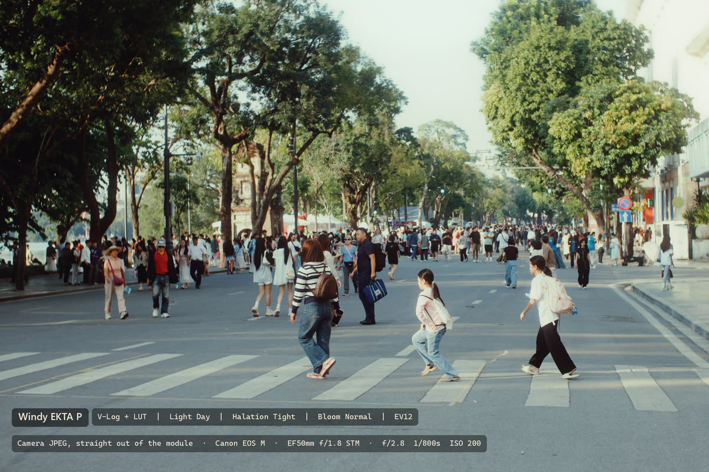
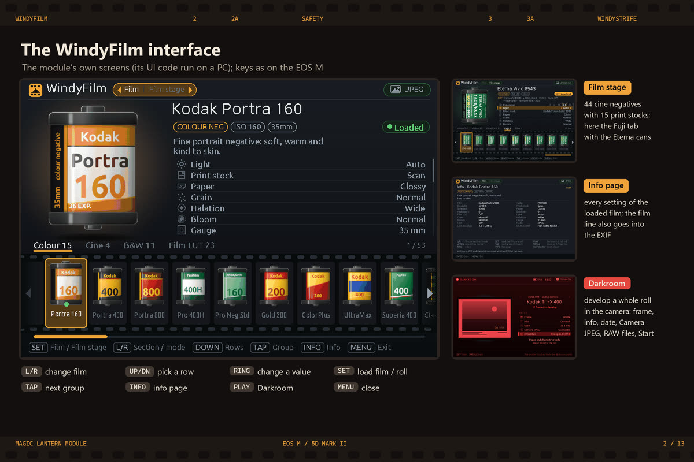
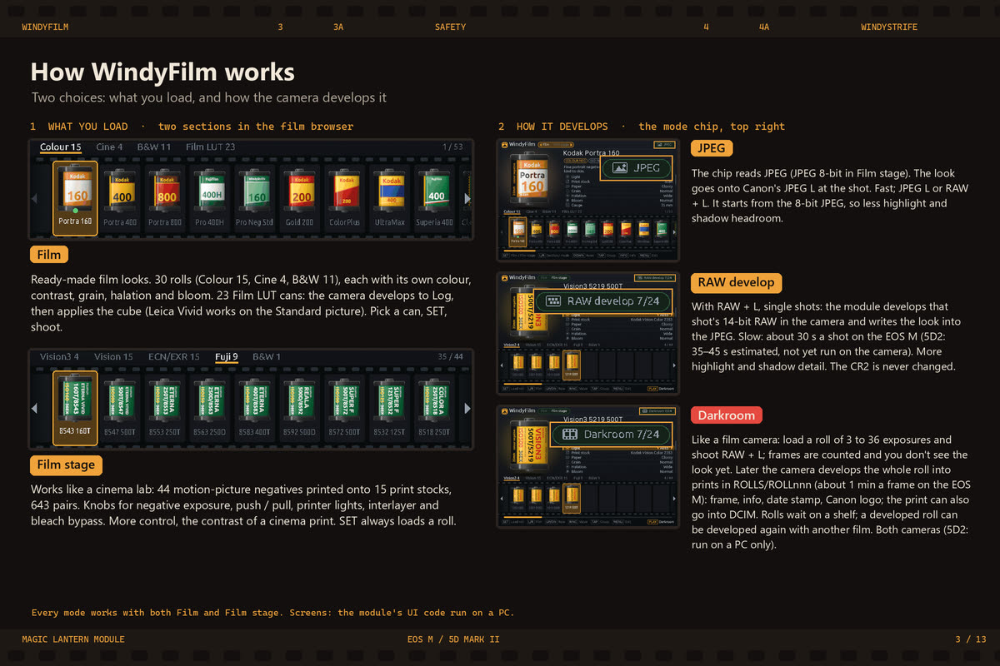
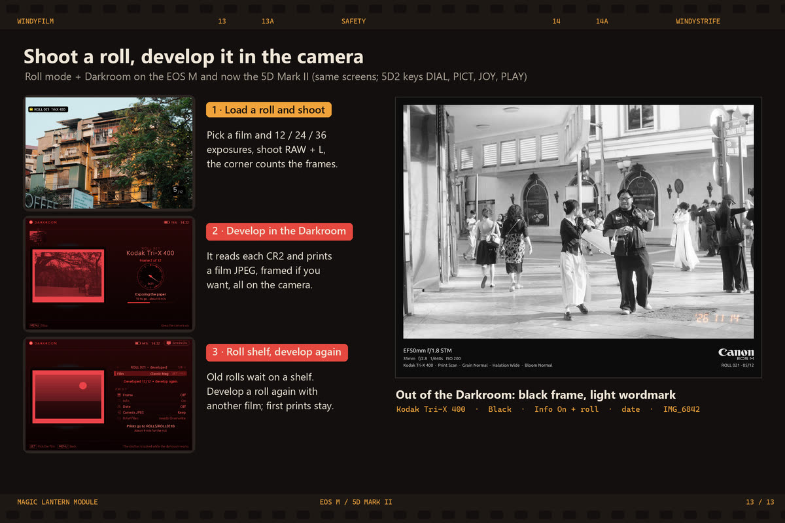
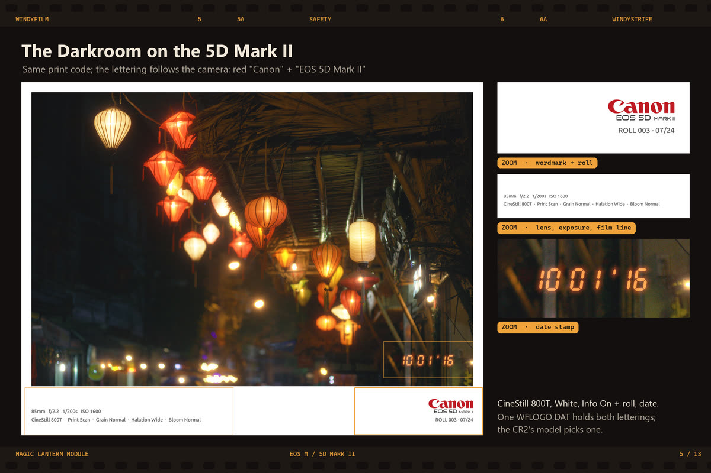
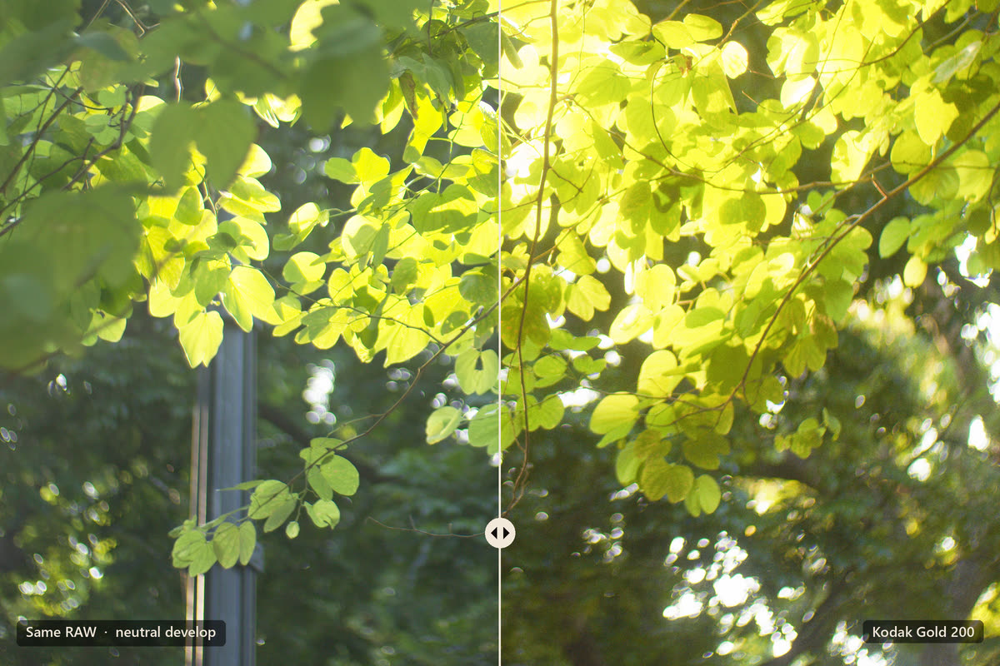
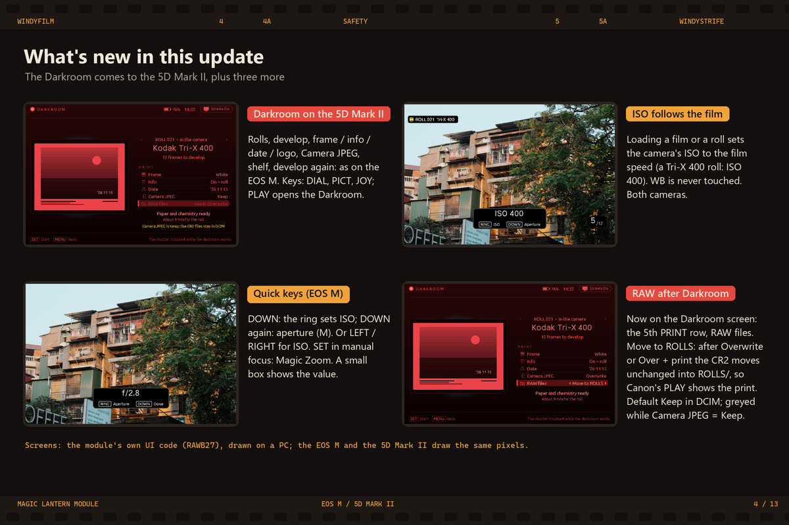

# WindyFilm

[Tiếng Việt](README.md) · **English** · [中文](README.zh.md) · [日本語](README.ja.md) · [한국어](README.ko.md)

A Magic Lantern module for the **Canon EOS M (firmware 2.0.2)** and the **Canon EOS 5D Mark II (2.1.2)**. WindyFilm
gives you film colour in the camera: a film look on the JPEG at the shot, a 14-bit RAW develop on the camera, or a
whole roll shot first and then developed in the Darkroom into framed prints. Author: **WindyStrife**. Licence
GPL-3.0-or-later (`LICENSE`); third-party data is credited in `ATTRIBUTIONS.md`.



> **Current build: RAWB27** (tag `RAWB27`, branch `main`). Host tests: EOS M 2289 checks, 5D2 1832 checks, 0 failures.
> **Not yet run on a camera:** the 5D2 Darkroom and RAW develop, moving the CR2 to ROLLS, the RAW files row, Quick
> keys, ISO from the film. The latest state (branches, cards, open items) is in `docs/HANDOFF.md`.

WindyFilm is a standalone module that replaces the old "Film Roll port". It does not use, load or contain anything
from the `filmroll.mo` module. **Do not enable both modules at once.**

## The interface

Open it with a shortcut: on the **EOS M**, hold DOWN in LiveView; on the **5D Mark II**, press TRASH. One screen shows
the film can, the film's name and chips, the setting rows, a 35 mm film strip, and the mode chip at the top right.



| Action | EOS M | 5D Mark II |
|---|---|---|
| Change film | left / right | joystick left / right |
| Pick a row | up / down | joystick up / down |
| Change a value | rear ring | top or rear dial; or press the joystick, then left / right |
| Load film / roll | SET | SET |
| Next film group | one-finger tap | PICT (Picture Style button) |
| Info page | INFO | INFO |
| Darkroom | PLAY | PLAY |
| Close | MENU or two-finger tap | MENU or TRASH |

A half or full shutter press closes the interface and the camera shoots as usual.

## How it works

You make two choices: **what you load** (Film or Film stage) and **how the camera develops it** (JPEG, RAW develop or
Darkroom). Every mode works with both Film and Film stage.



**What you load**
- **Film**: ready-made film looks. 30 rolls (Colour 15, Cine 4, B&W 11), each with its own colour, contrast, grain,
  halation and bloom. Plus 23 **Film LUT** cans: the camera records Log, then applies the cube.
- **Film stage**: works like a cinema lab. 44 motion-picture negatives printed onto 15 print stocks (643 pairs), with
  rows for negative exposure, push / pull, RGB printer lights, interlayer and bleach bypass.

**How the camera develops it** (the mode chip)
- **JPEG** (*JPEG 8-bit* in Film stage): the look goes onto Canon's JPEG L at the shot. Fast, but it starts from an 8-bit
  JPEG, so there is less highlight and shadow detail.
- **RAW develop**: shoot RAW + L, one shot at a time. The module develops that shot's 14-bit RAW in the camera and writes
  the look into the JPEG, about 30 s a shot on the EOS M. More detail is kept. The CR2 is never changed.
- **Darkroom**: like a film camera. Load a roll of 3–36 exposures and shoot RAW + L; frames are counted and you don't see
  the look yet. Later the camera develops the whole roll into prints in `ROLLS/ROLLnnn` (about 1 min a frame on the
  EOS M).

**Film rows:** Light (Auto · Day · Cloudy · Shade · Tungsten), Print stock, Paper (Glossy · Matte · Warm · Cool), Grain,
Halation, Bloom, Gauge, and Exposures for a roll. *Light Auto* keeps your white balance; the other choices set the WB
from the film, and your own WB comes back when you return to Auto or turn the module off. Loading a film or roll sets
the camera's **ISO from the film**.

## Darkroom



The **PRINT** block on the Darkroom screen:
- **Frame**: Off · White · Black · White wide · Black wide (the paper border around the picture).
- **Info**: Off · On · On + roll (lens, exposure, film line, roll number).
- **Date**: a film-camera date stamp.
- **Camera JPEG**: Keep (prints stay in ROLLS) · Overwrite (the print replaces the JPEG in DCIM) · Over + print (keeps the
  picture in DCIM and adds the framed print `WFP_nnnn.JPG` beside it).
- **RAW files**: Keep in DCIM · Move to ROLLS. The CR2 moves only when Camera JPEG is Overwrite or Over + print, and
  only after the JPEG has been checked; the CR2's content is never changed. This is the same setting as *RAW after
  Darkroom* in the ML menu.

Developed rolls wait on a **shelf**. A roll can be developed again with another film (into `ROLLnnnB`); the first prints
stay. The screen can be switched off (Screen Off) while the camera develops, to save battery.



## Before / after



## New in RAWB27



- The Darkroom on the 5D Mark II, with the same screens as the EOS M.
- The **RAW files** row on the Darkroom screen.
- **ISO from the film** on both cameras.
- **Quick keys** on the EOS M: a short DOWN press makes the ring set ISO; DOWN again sets the aperture (M mode); SET in
  manual focus opens Magic Zoom.
- Bolder, easier-to-read captions on the prints.

The full list is on the RAWB27 release page, which also carries the PDF manuals (Vietnamese and English).

## Cards

A WindyFilm card lives in its own folder (for example `EOSM_WindyFilm_RAWB27`, `5D2_WindyFilm_RAWB27`) and is made by
`tools/mk_card.sh` from the build plus the owner's private data. Cards are not in this repo.

```
autoexec.bin, ML/modules/<camera>.sym  always a matching pair; keep the pair you have
ML/modules/windyflm.mo                 the module
ML/data/WFFILMS.DAT                    the films' colour tables
ML/data/WFSTAGE.DAT, WFSTLOG.DAT       Film stage (JPEG 8-bit, RAW develop)
ML/data/WFLOG.DAT                      RAW develop tables
ML/data/WFPRINT.DAT, WFLOGO.DAT        paper, lettering and logo for the print frame
ML/data/WFCANS.DAT, WFFONTS.DAT        film can pictures, interface fonts
ML/data/*.CUB                          Film LUT cubes
ML/SETTINGS/WINDYFLM.EN                loads the module at start-up
README_WINDYFILM.txt, MD5SUMS.txt and the licence files
```

`filmroll.mo` must not be on a WindyFilm card.

## Build and test (WSL Ubuntu-24.04)

```bash
bash build.sh CAM=EOSM
bash build.sh CAM=5D2
bash test.sh
```

Run them from a script file in WSL. `build.sh` checks that:
- every symbol the module uses is in the card's `.sym` file;
- the image size fits when TCC links it;
- the provenance gate passes (`tools/provenance_gate.py`): no string or byte run matches the old module.

Do not run the EOS M and 5D2 test suites at the same time.

## Documents

- `docs/HANDOFF.md`: the one entry point: current state, branch map, cards, open items, log.
- `docs/DESIGN.md`: architecture, card file formats, interfaces between the parts.
- `docs/UI-NOTES.md`, `docs/CORE-NOTES.md`, `docs/DATA-NOTES.md`: notes on the interface, the ML core and the data.
- `ATTRIBUTIONS.md`: credits for third-party data and specifications.

*README pictures: the screens are the module's own UI code run on a PC (the EOS M and the 5D2 draw the same pixels);
the prints and photos are the owner's, shot on cameras running WindyFilm.*
