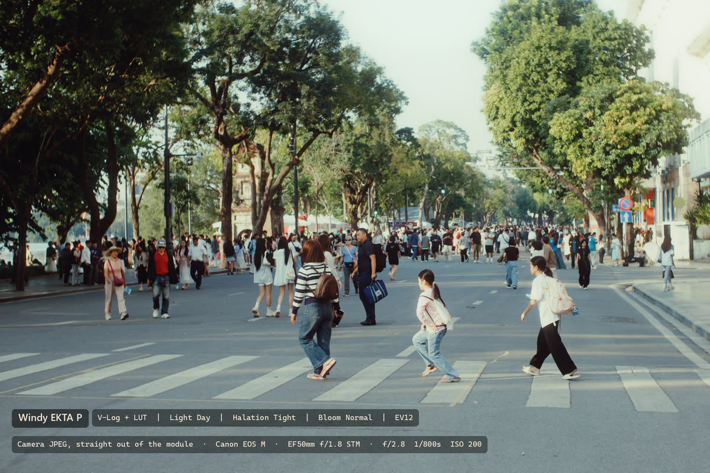
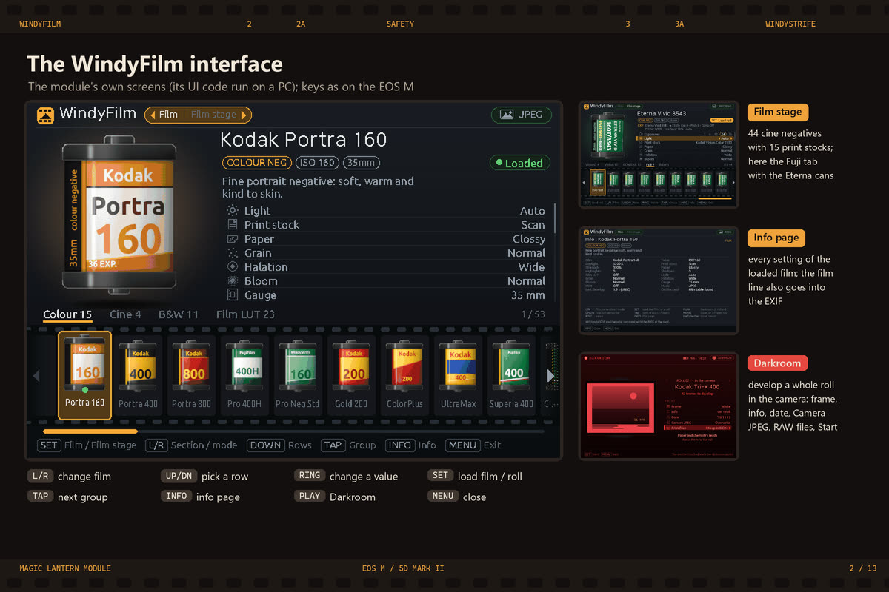
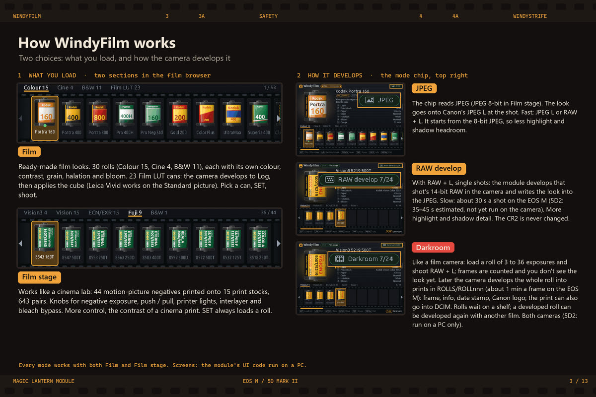
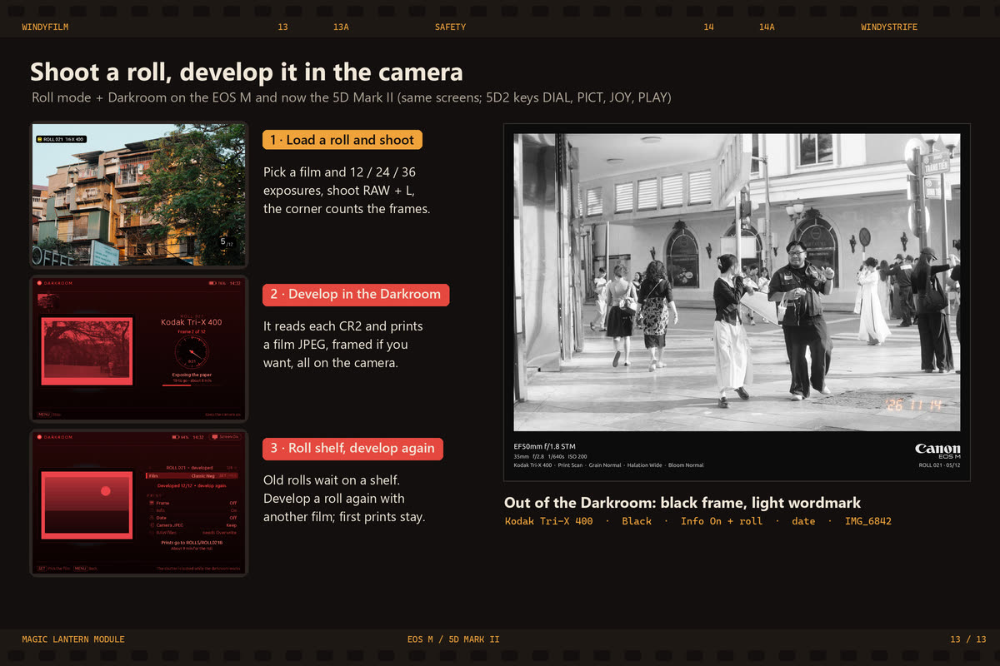
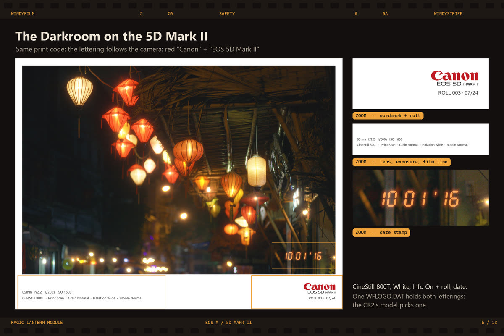
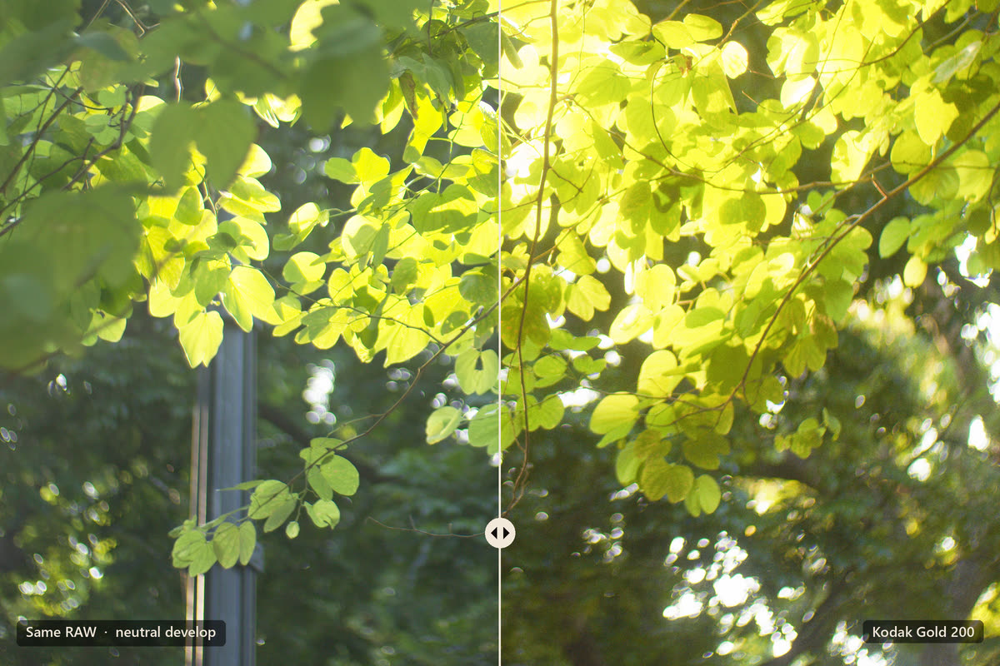
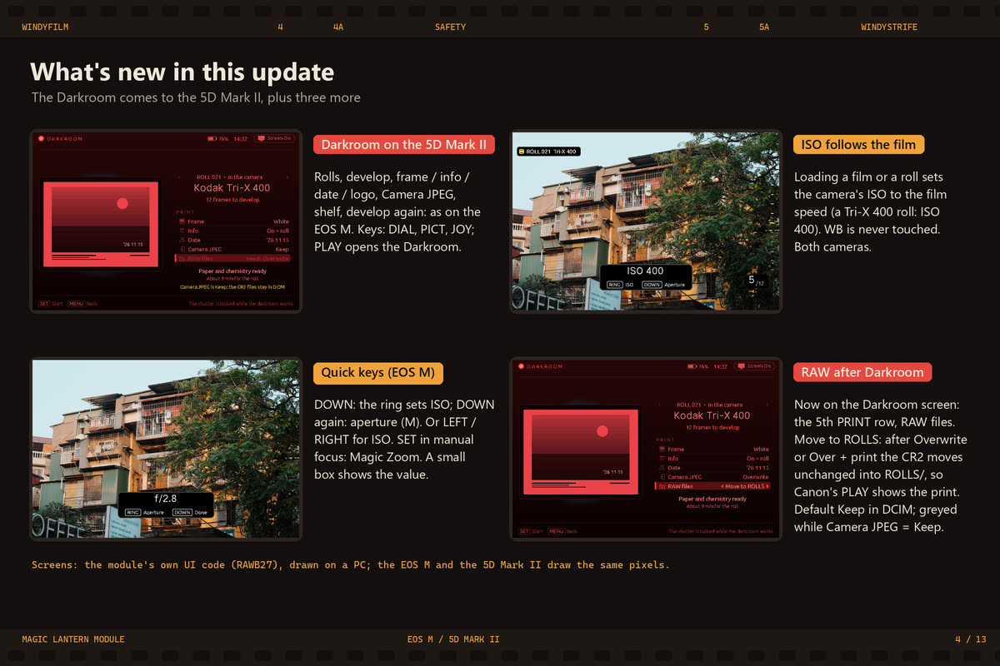

# WindyFilm

[Tiếng Việt](README.md) · [English](README.en.md) · [中文](README.zh.md) · **日本語** · [한국어](README.ko.md)

**Canon EOS M (firmware 2.0.2)** と **Canon EOS 5D Mark II (2.1.2)** 用の Magic Lantern モジュールです。
WindyFilm を使うと、カメラの中でフィルムの色が手に入ります。撮影時の JPEG にフィルムルックをかけることも、14-bit
RAW をカメラ内で現像することも、ロール 1 本を撮り切ってから Darkroom（暗室）でフレーム付きのプリントに現像することもできます。
作者：**WindyStrife**。ライセンスは GPL-3.0-or-later（`LICENSE`）で、第三者データのクレジットは `ATTRIBUTIONS.md` にあります。



> **現在のビルド：RAWB27**（タグ `RAWB27`、ブランチ `main`）。ホストテスト：EOS M 2289 件、5D2 1832 件のチェックで失敗 0。
> **まだ実機で試していないもの**：5D2 の Darkroom と RAW develop、CR2 の ROLLS への移動、RAW files 行、Quick
> keys、フィルムに合わせた ISO。最新の状況（ブランチ、カード、未解決の項目）は `docs/HANDOFF.md` にあります。

WindyFilm は、以前の「Film Roll port」に代わる独立したモジュールです。
`filmroll.mo` モジュールのものは、使うことも、読み込むことも、含むこともありません。
**2 つのモジュールを同時に有効にしないでください。**

## インターフェース

ショートカットで開きます。**EOS M** では LiveView 中に DOWN を長押し、**5D Mark II** では TRASH を押します。
1 つの画面に、フィルム缶、フィルム名とチップ、設定の各行、35 mm のフィルムストリップ、右上のモードチップが並びます。



| 操作 | EOS M | 5D Mark II |
|---|---|---|
| フィルムを変える | 左 / 右 | ジョイスティック左 / 右 |
| 行を選ぶ | 上 / 下 | ジョイスティック上 / 下 |
| 値を変える | 背面のリング | 上面か背面のダイヤル。またはジョイスティックを押してから左 / 右 |
| フィルム / ロールを装填 | SET | SET |
| 次のフィルムグループ | 1 本指でタップ | PICT（ピクチャースタイルボタン） |
| Info ページ | INFO | INFO |
| Darkroom | PLAY | PLAY |
| 閉じる | MENU または 2 本指でタップ | MENU または TRASH |

シャッターボタンを半押しまたは全押しするとインターフェースが閉じ、カメラは通常どおり撮影します。

## 仕組み

選ぶのは 2 つです。**何を装填するか**（Film か Film stage）と、**カメラがどう現像するか**（JPEG、RAW develop、Darkroom）。
どのモードも Film と Film stage の両方で使えます。



**何を装填するか**
- **Film**：出来上がったフィルムルックです。30 本のロール（Colour 15、Cine 4、B&W 11）があります。
  それぞれ独自の色、コントラスト、粒子、ハレーション、ブルームを持っています。
  さらに 23 個の **Film LUT** 缶があり、カメラが Log で記録してから cube を適用します。
- **Film stage**：映画の現像所のように動きます。44 種の映画用ネガを 15 種のプリントフィルムに焼き付けます（643 組）。
  ネガ露光、増感 / 減感（push / pull）、RGB 配光、インターレイヤー、銀残し（bleach bypass）の設定行もあります。

**カメラがどう現像するか**（モードチップ）
- **JPEG**（Film stage では *JPEG 8-bit*）：撮影時に Canon の JPEG L にルックをかけます。速いですが、8-bit JPEG
  から始めるので、ハイライトとシャドウのディテールは少なくなります。
- **RAW develop**：RAW + L で 1 枚ずつ撮影します。モジュールがその 1 枚の 14-bit RAW をカメラ内で現像し、ルックを
  JPEG に書き込みます。EOS M では 1 枚あたり約 30 秒です。より多くのディテールが残ります。CR2 は一切変更されません。
- **Darkroom**：フィルムカメラのように使います。3–36 枚撮りのロールを装填し、RAW + L で撮影します。
  コマ数はカウントされますが、ルックはまだ見えません。あとでカメラがロール全体をプリントに現像し、`ROLLS/ROLLnnn`
  に保存します（EOS M では 1 コマ約 1 分）。

**フィルムの設定行**：Light（Auto · Day · Cloudy · Shade · Tungsten）、Print stock、Paper（Glossy · Matte · Warm ·
Cool）、Grain、Halation、Bloom、Gauge、そしてロール用の Exposures。*Light Auto* は今のホワイトバランスをそのまま使います。
ほかの選択肢はフィルムに合わせて WB を設定し、Auto に戻すかモジュールをオフにすると自分の WB に戻ります。
フィルムやロールを装填すると、カメラが**フィルムに合わせた ISO** に設定されます。

## Darkroom



Darkroom 画面の **PRINT** ブロック：
- **Frame**：Off · White · Black · White wide · Black wide（写真のまわりの紙のふち）。
- **Info**：Off · On · On + roll（レンズ、露出、フィルム名の行、ロール番号）。
- **Date**：フィルムカメラ風の日付写し込み。
- **Camera JPEG**：Keep（プリントは ROLLS に残る）· Overwrite（プリントが DCIM の JPEG を置き換える）· Over + print（DCIM
  に写真を残し、その横にフレーム付きプリント `WFP_nnnn.JPG` を追加する）。
- **RAW files**：Keep in DCIM · Move to ROLLS。CR2 が移動するのは Camera JPEG が Overwrite か Over + print
  のときだけで、しかも JPEG のチェックが済んでからです。CR2 の中身は一切変更されません。
  これは ML メニューの *RAW after Darkroom* と同じ設定です。

現像済みのロールは **shelf**（棚）で待機します。
別のフィルムでロールをもう一度現像することもでき（`ROLLnnnB` に出力）、最初のプリントはそのまま残ります。
カメラが現像している間は、バッテリー節約のため画面を消せます（Screen Off）。



## ビフォー / アフター



## RAWB27 の新機能



- 5D Mark II の Darkroom。画面は EOS M と同じです。
- Darkroom 画面の **RAW files** 行。
- 両方のカメラで**フィルムに合わせた ISO**。
- EOS M の **Quick keys**：DOWN を短く押すとリングで ISO を設定でき、もう一度 DOWN で絞り（M モード）を設定します。
  マニュアルフォーカス中に SET を押すと Magic Zoom が開きます。
- プリントのキャプションが太くなり、読みやすくなりました。

全項目は RAWB27 のリリースページにあり、PDF マニュアル（ベトナム語と英語）も同じページにあります。

## カード

WindyFilm のカードはそれぞれ専用のフォルダーにあり（例：`EOSM_WindyFilm_RAWB27`、`5D2_WindyFilm_RAWB27`）、`tools/mk_card.sh`
がビルド結果とプロジェクトオーナーの非公開データから作成します。カードはこのリポジトリには含まれていません。

```
autoexec.bin, ML/modules/<camera>.sym  always a matching pair; keep the pair you have
ML/modules/windyflm.mo                 the module
ML/data/WFFILMS.DAT                    the films' colour tables
ML/data/WFSTAGE.DAT, WFSTLOG.DAT       Film stage (JPEG 8-bit, RAW develop)
ML/data/WFLOG.DAT                      RAW develop tables
ML/data/WFPRINT.DAT, WFLOGO.DAT        paper, lettering and logo for the print frame
ML/data/WFCANS.DAT, WFFONTS.DAT        film can pictures, interface fonts
ML/data/*.CUB                          Film LUT cubes
ML/SETTINGS/WINDYFLM.EN                loads the module at start-up
README_WINDYFILM.txt, MD5SUMS.txt and the licence files
```

`filmroll.mo` を WindyFilm のカードに入れてはいけません。

## ビルドとテスト（WSL Ubuntu-24.04）

```bash
bash build.sh CAM=EOSM
bash build.sh CAM=5D2
bash test.sh
```

WSL 上で、スクリプトファイルから実行してください。`build.sh` は次の点をチェックします。
- モジュールが使うすべてのシンボルが、カードの `.sym` ファイルにあること。
- TCC でリンクしたときに、イメージサイズが収まること。
- 来歴ゲート（`tools/provenance_gate.py`）を通過すること。旧モジュールと一致する文字列やバイト列が一つもないこと。

EOS M と 5D2 のテストスイートを同時に実行しないでください。

## ドキュメント

- `docs/HANDOFF.md`：唯一の入口。現在の状況、ブランチマップ、カード、未解決の項目、ログ。
- `docs/DESIGN.md`：アーキテクチャ、カードのファイル形式、各部分の間のインターフェース。
- `docs/UI-NOTES.md`、`docs/CORE-NOTES.md`、`docs/DATA-NOTES.md`：インターフェース、ML コア、データについてのメモ。
- `ATTRIBUTIONS.md`：第三者のデータと仕様のクレジット。

*README の画像：画面はモジュール自身の UI コードを PC で動かしたものです（EOS M と 5D2 は同じピクセルを描画します）。
プリントと写真はプロジェクトオーナーのもので、WindyFilm を入れたカメラで撮影しています。*
