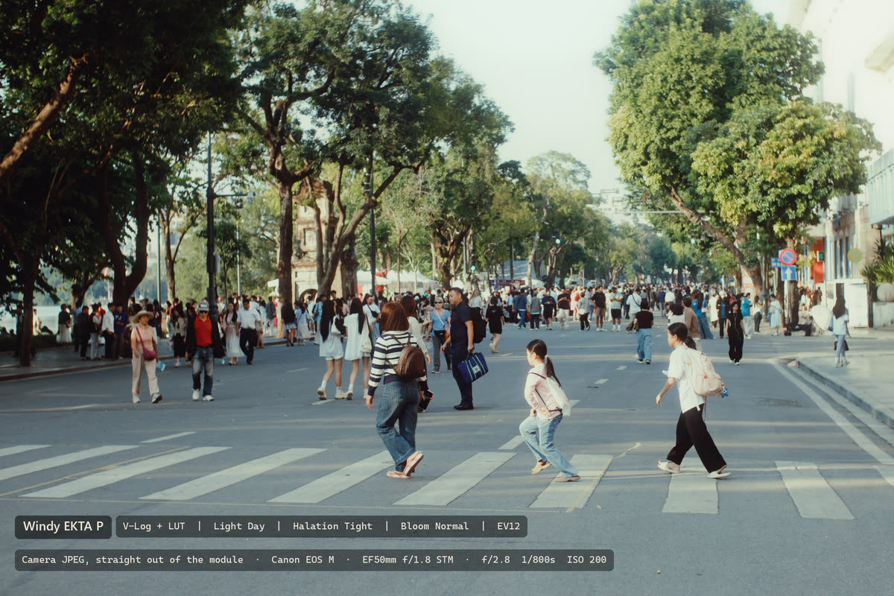
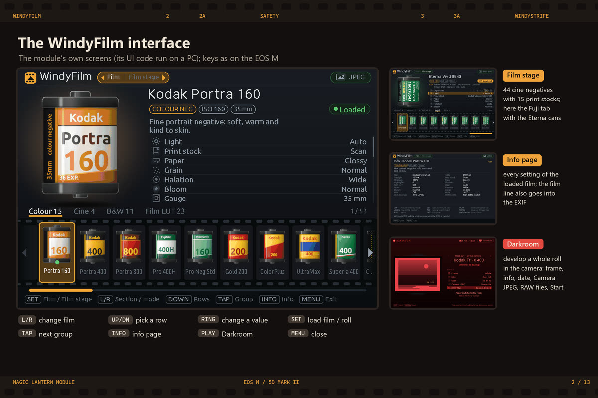
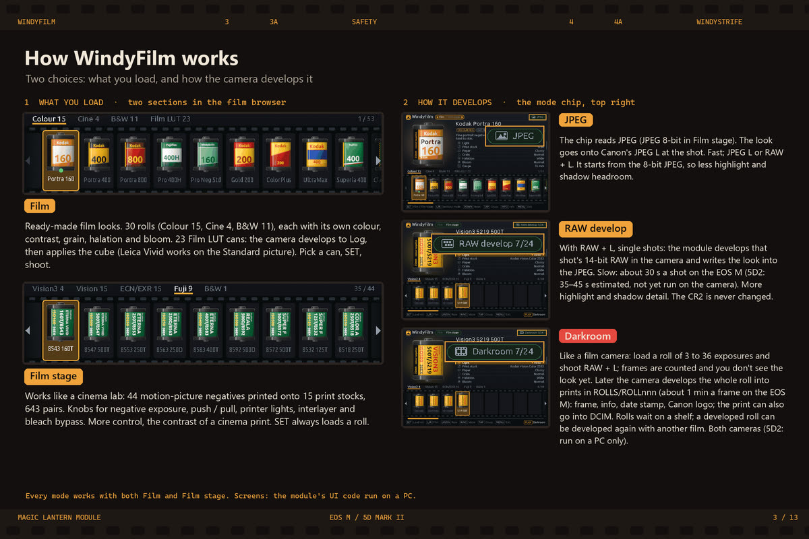
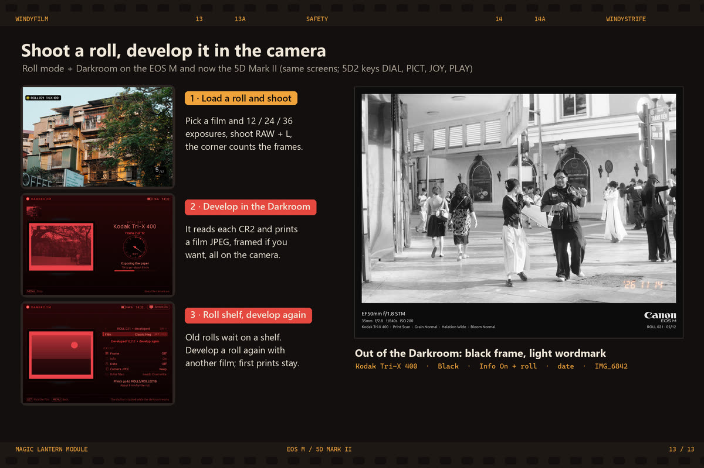
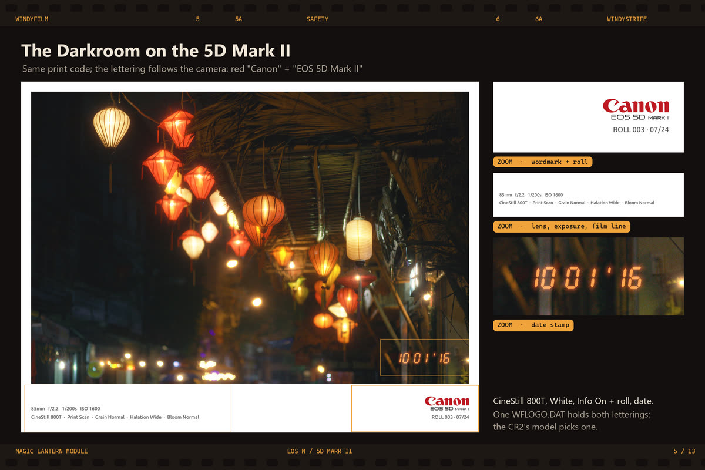
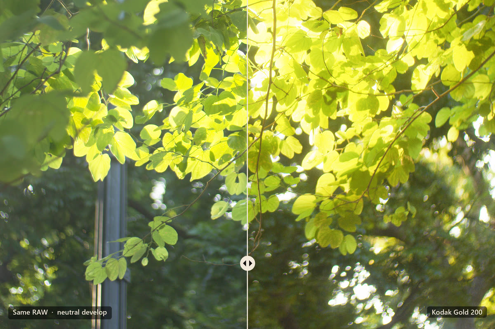
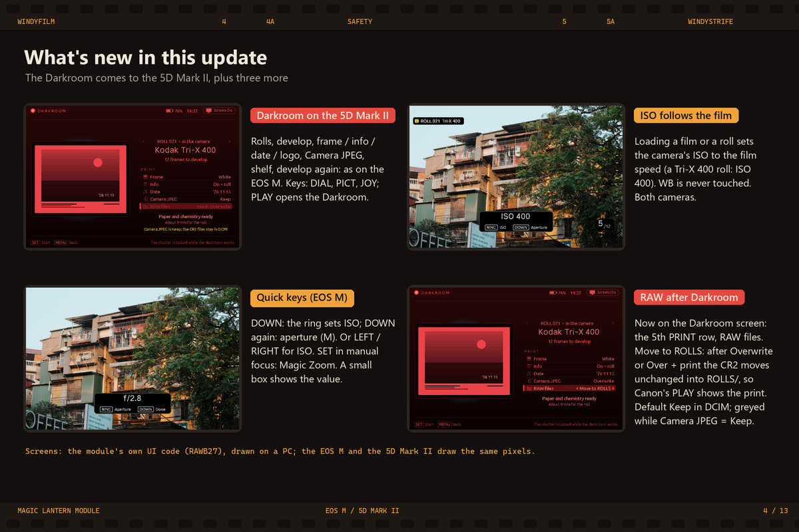

# WindyFilm

[Tiếng Việt](README.md) · [English](README.en.md) · [中文](README.zh.md) · [日本語](README.ja.md) · **한국어**

**Canon EOS M (firmware 2.0.2)**, **Canon EOS 5D Mark II (2.1.2)** 두 기종을 위한 Magic Lantern 모듈입니다.
WindyFilm은 카메라 안에서 필름 색감을 만들어 줍니다. 촬영할 때 JPEG에 필름 룩을 입히거나, 카메라에서 14-bit RAW를
현상하거나, 먼저 롤 하나를 다 찍은 뒤 Darkroom(암실)에서 테두리가 있는 프린트로 현상할 수 있습니다. 제작자:
**WindyStrife**. 라이선스 GPL-3.0-or-later(`LICENSE`), 서드파티 데이터의 크레딧은 `ATTRIBUTIONS.md`에 있습니다.



> **현재 빌드: RAWB28** (태그 `RAWB28`, 브랜치 `main`). 호스트 테스트: EOS M 2330개, 5D2 1848개 검사에서 실패 0건.
> **아직 실제 카메라에서 돌려 보지 않은 것:** Darkroom의 사진 보기, Camera JPEG의 Print + over, 새 Quick keys,
> Blind roll 줄. 이전 빌드부터: 5D2의 Darkroom과 RAW develop, CR2를 ROLLS로 옮기기, RAW files 줄, 필름 기준 ISO.

WindyFilm은 예전의 "Film Roll port"를 대체하는 독립 모듈입니다. `filmroll.mo` 모듈의 어떤 것도 사용하거나, 불러오거나,
포함하지 않습니다. **두 모듈을 동시에 켜지 마세요.**

## 인터페이스

단축키로 엽니다. **EOS M**에서는 LiveView 중에 DOWN을 길게 누르고, **5D Mark II**에서는 TRASH를 누릅니다. 한 화면에
필름 캔, 필름 이름과 칩, 설정 줄들, 35 mm 필름 스트립, 오른쪽 위의 모드 칩이 표시됩니다.



| 동작 | EOS M | 5D Mark II |
|---|---|---|
| 필름 바꾸기 | 왼쪽 / 오른쪽 | 조이스틱 왼쪽 / 오른쪽 |
| 줄 고르기 | 위 / 아래 | 조이스틱 위 / 아래 |
| 값 바꾸기 | 후면 링 | 상단 또는 후면 다이얼, 또는 조이스틱을 누른 뒤 왼쪽 / 오른쪽 |
| 필름 / 롤 넣기 | SET | SET |
| 다음 필름 그룹 | 한 손가락 탭 | PICT (픽처 스타일 버튼) |
| Info 페이지 | INFO | INFO |
| Darkroom | PLAY | PLAY |
| 닫기 | MENU 또는 두 손가락 탭 | MENU 또는 TRASH |

셔터 버튼을 반쯤 또는 끝까지 누르면 인터페이스가 닫히고 카메라는 평소처럼 촬영합니다.

## 작동 방식

고를 것은 두 가지입니다. **무엇을 넣을지**(Film 또는 Film stage)와 **카메라가 어떻게 현상할지**(JPEG, RAW develop
또는 Darkroom). 모든 모드는 Film과 Film stage 양쪽에서 쓸 수 있습니다.



**무엇을 넣을지**
- **Film**: 미리 만들어 둔 필름 룩입니다. 30롤(Colour 15, Cine 4, B&W 11)이며, 롤마다 고유한 색감, 콘트라스트, 그레인,
  할레이션, 블룸이 있습니다. 여기에 **Film LUT** 캔 23개가 더 있으며, 카메라가 Log로 기록한 뒤 cube를 적용합니다.
- **Film stage**: 영화 현상소처럼 작동합니다. 영화용 네거티브 44종을 프린트 필름 15종에 인화합니다(643개 조합).
  네거티브 노출, 증감 / 감감(push / pull), RGB 프린터 라이트, 인터레이어, 블리치 바이패스를 조절하는 줄이 있습니다.

**카메라가 어떻게 현상할지** (모드 칩)
- **JPEG** (Film stage에서는 *JPEG 8-bit*): 촬영할 때 Canon의 JPEG L에 룩을 입힙니다. 빠르지만 8-bit JPEG에서
  시작하므로 하이라이트와 섀도 디테일이 적습니다.
- **RAW develop**: RAW + L로 한 장씩 찍습니다. 모듈이 그 장의 14-bit RAW를 카메라 안에서 현상해 룩을 JPEG에 기록하며,
  EOS M에서는 한 장에 약 30초 걸립니다. 디테일이 더 많이 남습니다. CR2는 절대 바뀌지 않습니다.
- **Darkroom**: 필름 카메라처럼 씁니다. 3–36컷짜리 롤을 넣고 RAW + L로 찍습니다. 카메라는 컷 수만 세고, 룩은 아직
  보여 주지 않습니다. 나중에 카메라가 롤 전체를 프린트로 현상해 `ROLLS/ROLLnnn`에 저장합니다(EOS M에서 한 컷에 약
  1분).

**필름 설정 줄:** Light (Auto · Day · Cloudy · Shade · Tungsten), Print stock, Paper (Glossy · Matte · Warm · Cool),
Grain, Halation, Bloom, Gauge, 그리고 롤용 Exposures. *Light Auto*는 지금의 화이트 밸런스를 그대로 둡니다. 나머지
선택지는 필름에 맞춰 WB를 설정하며, Auto로 돌아가거나 모듈을 끄면 원래의 WB가 돌아옵니다. 필름이나 롤을 넣으면
카메라에 **필름 기준 ISO**가 설정됩니다.

## Darkroom



Darkroom 화면의 **PRINT** 블록:
- **Frame**: Off · White · Black · White wide · Black wide (사진 둘레의 인화지 테두리).
- **Info**: Off · On · On + roll (렌즈, 노출, 필름 이름 줄, 롤 번호).
- **Date**: 필름 카메라식 날짜 각인.
- **Camera JPEG**: Keep (프린트는 ROLLS에 남음) · Overwrite (프린트가 DCIM의 JPEG을 대체) · Over + print (DCIM에는
  테두리 없는 사진) · Print + over (DCIM에는 테두리가 있는 프린트, 테두리 없는 사진은 프린트 `F01_nnnn.JPG` 옆의
  `ROLLS/ROLLnnn/IMG_nnnn.JPG`로). DCIM에는 컷마다 JPEG이 하나만 남고, Canon의 PLAY가 그것을 보여 줍니다. 프린트는
  항상 ROLLS에 있습니다.
- **RAW files**: Keep in DCIM · Move to ROLLS. CR2는 Camera JPEG 설정이 Keep이 아닐 때만, 그리고 JPEG
  검사가 끝난 뒤에만 옮겨집니다. CR2의 내용은 절대 바뀌지 않습니다. ML 메뉴의 *RAW after Darkroom*과 같은 설정입니다.

현상된 롤은 **shelf**(선반)에서 기다립니다. 롤은 다른 필름으로 다시 현상할 수 있고(`ROLLnnnB`로 출력), 처음 프린트는
그대로 남습니다. 카메라가 현상하는 동안 배터리를 아끼기 위해 화면을 끌 수 있습니다(Screen Off).



## 비포 / 애프터



## RAWB28의 새 기능

- **Darkroom의 사진**: ROLL 줄에서는 확대기 받침에 롤의 밀착 인화(콘택트 시트)가 나옵니다(12컷 이하의 롤은 컷이 더
  큽니다). PRINT 줄에서는 처음 인화할 컷의 사진 그대로 만든 프린트 초안이 나옵니다. 사진은 각 CR2 안의 작은 미리보기에서
  가져옵니다(RAW 데이터는 읽지 않음). INFO로 숨기거나 보이게 합니다.
- **Camera JPEG** 선택지가 4개가 되었습니다: Keep, Overwrite, Over + print, Print + over. DCIM에는 컷마다 JPEG이 하나만
  남아서 Canon의 PLAY로 볼 수 있습니다. DCIM에 `WFP_` 파일은 더 이상 생기지 않습니다.
- EOS M의 **Quick keys**가 일반 LiveView에서도 작동합니다. 그곳에서는 링을 돌려도 Canon이 셔터 속도(또는 조리개)를
  바꾼 것으로만 모듈에 전달되므로, WindyFilm이 이를 ISO나 조리개 단계로 되돌립니다.
- WindyFilm의 Exposures 아래에 **Blind roll** 줄. Off로 하면 롤을 넣은 채로도 촬영 후 확인과 PLAY를 쓸 수 있습니다.

전체 목록은 RAWB28 릴리스 페이지에 있으며, PDF 매뉴얼(베트남어, 영어)도 그 페이지에 있습니다.

## RAWB27의 새 기능



- 5D Mark II의 Darkroom. 화면은 EOS M과 같습니다.
- Darkroom 화면의 **RAW files** 줄.
- 두 카메라 모두에서 **필름 기준 ISO**.
- EOS M의 **Quick keys**: DOWN을 짧게 누르면 링으로 ISO를 설정하고, DOWN을 한 번 더 누르면 조리개를 설정합니다(M 모드).
  수동 초점일 때 SET을 누르면 Magic Zoom이 열립니다.
- 프린트의 캡션이 더 굵고 읽기 쉬워졌습니다.

## 카드

WindyFilm 카드는 각각 전용 폴더에 들어 있으며(예: `EOSM_WindyFilm_RAWB28`, `5D2_WindyFilm_RAWB28`), 빌드 결과와
프로젝트 소유자의 비공개 데이터로 `tools/mk_card.sh`가 만듭니다. 카드는 이 저장소에 없습니다. 카드 전체는 릴리스 페이지의
zip 파일입니다.

```
autoexec.bin, ML/modules/<camera>.sym  always a matching pair; keep the pair you have
ML/modules/windyflm.mo                 the module
ML/data/WFFILMS.DAT                    the films' colour tables
ML/data/WFSTAGE.DAT, WFSTLOG.DAT       Film stage (JPEG 8-bit, RAW develop)
ML/data/WFLOG.DAT                      RAW develop tables
ML/data/WFPRINT.DAT, WFLOGO.DAT        paper, lettering and logo for the print frame
ML/data/WFCANS.DAT, WFFONTS.DAT        film can pictures, interface fonts
ML/data/*.CUB                          Film LUT cubes
ML/SETTINGS/WINDYFLM.EN                loads the module at start-up
README_WINDYFILM.txt, MD5SUMS.txt and the licence files
```

`filmroll.mo`는 WindyFilm 카드에 있으면 안 됩니다.

## 빌드와 테스트 (WSL Ubuntu-24.04)

```bash
bash build.sh CAM=EOSM
bash build.sh CAM=5D2
bash test.sh
```

WSL에서 스크립트 파일로 실행하세요. `build.sh`는 다음을 확인합니다.
- 모듈이 쓰는 모든 심볼이 카드의 `.sym` 파일에 있는지;
- TCC가 링크할 때 이미지 크기가 들어맞는지;
- 출처 게이트(`tools/provenance_gate.py`)를 통과하는지: 예전 모듈과 일치하는 문자열이나 바이트 열이 하나도 없는지.

EOS M과 5D2 테스트 스위트를 동시에 실행하지 마세요.

## 문서

- `docs/DESIGN.md`: 아키텍처, 카드 파일 형식, 각 부분 사이의 인터페이스.
- `docs/UI-NOTES.md`, `docs/CORE-NOTES.md`, `docs/DATA-NOTES.md`: 인터페이스, ML 코어, 데이터에 대한 노트.
- `ATTRIBUTIONS.md`: 서드파티 데이터와 사양의 크레딧.

*README 이미지: 화면은 모듈 자체의 UI 코드를 PC에서 실행한 것입니다(EOS M과 5D2는 같은 픽셀을 그립니다). 프린트와
사진은 프로젝트 소유자의 것으로, WindyFilm을 실행하는 카메라로 찍었습니다.*
