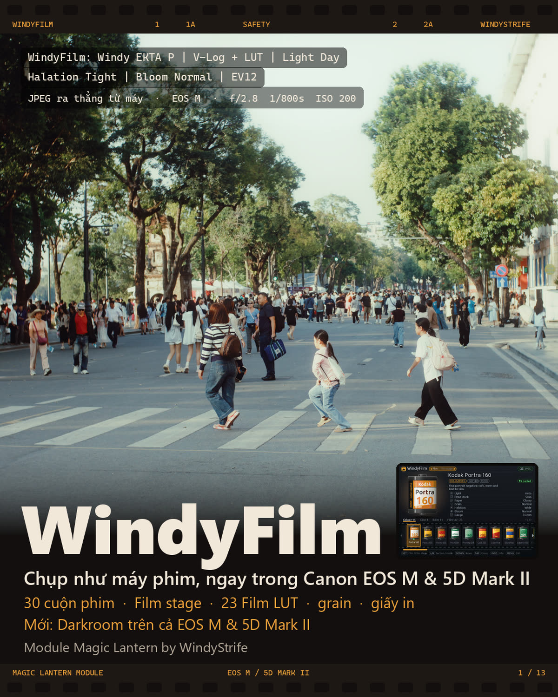
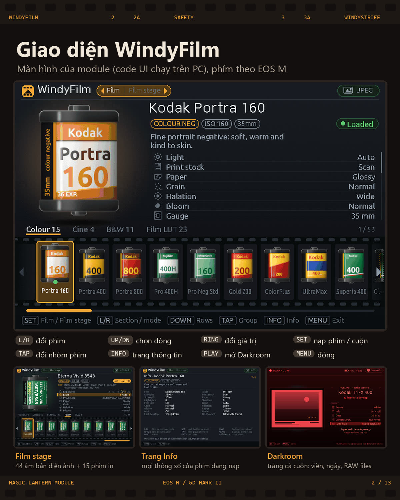
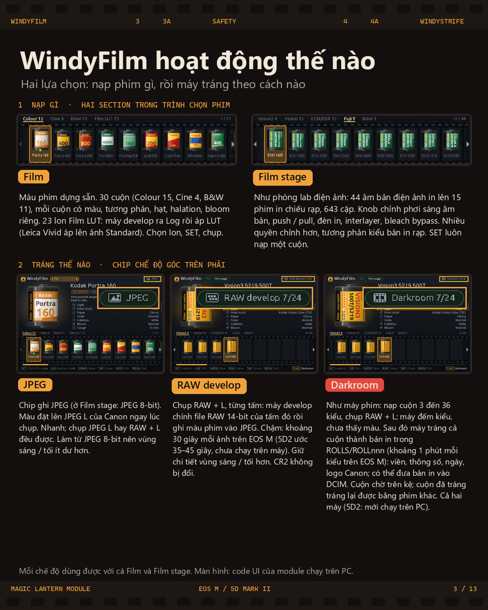
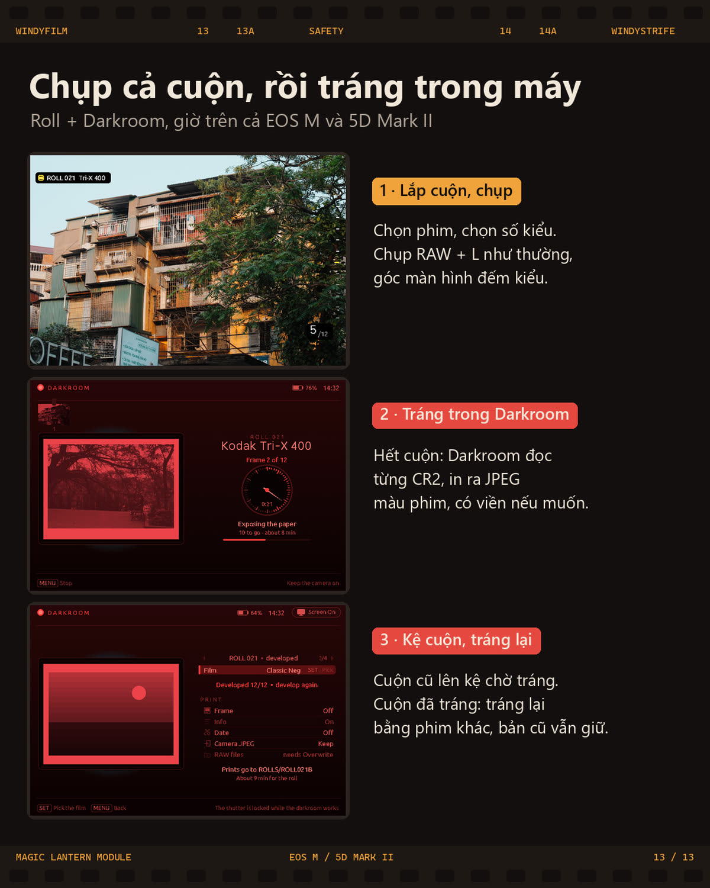
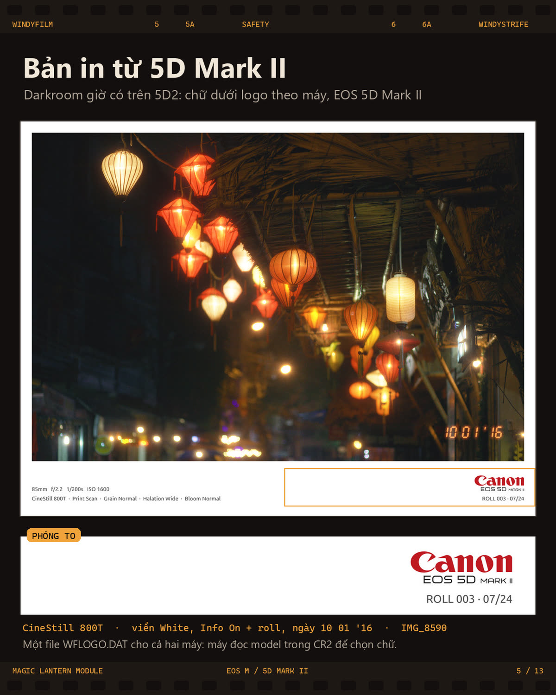
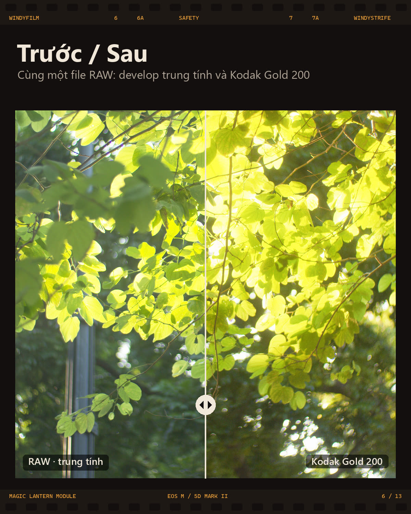
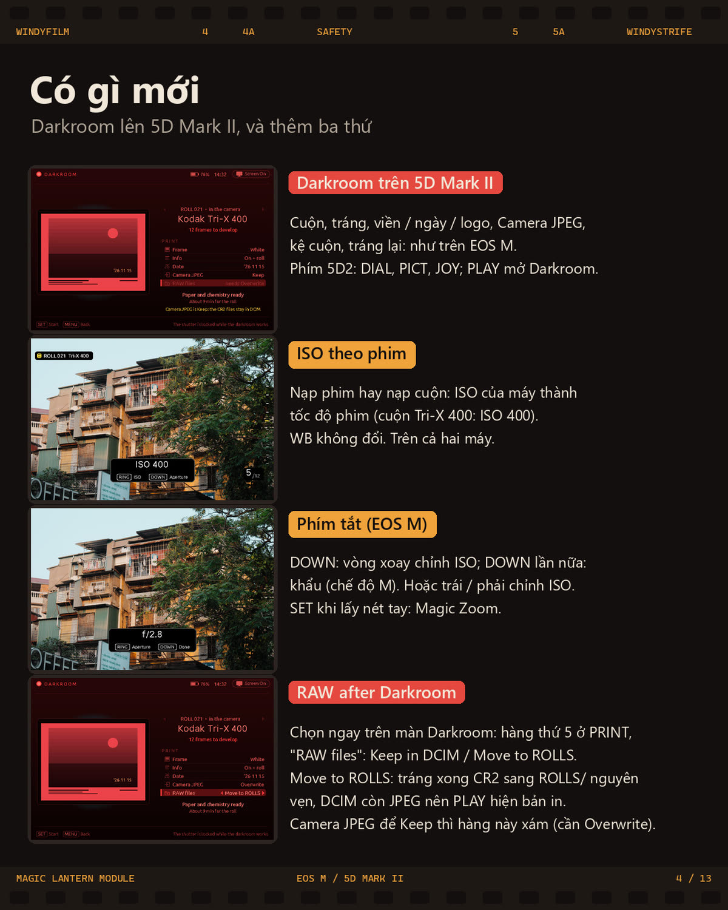

# WindyFilm

**Tiếng Việt** · [English](README.en.md) · [中文](README.zh.md) · [日本語](README.ja.md) · [한국어](README.ko.md)

Module Magic Lantern cho **Canon EOS M (firmware 2.0.2)** và **Canon EOS 5D Mark II (2.1.2)**. WindyFilm cho ảnh màu
phim ngay trong máy: màu phim lên JPEG lúc chụp, develop file RAW 14-bit ngay trên máy, hoặc chụp cả cuộn rồi tráng
trong Darkroom thành bản in có khung. Tác giả: **WindyStrife**. Giấy phép GPL-3.0 trở lên (`LICENSE`); dữ liệu bên thứ ba ghi ở
`ATTRIBUTIONS.md`.



> **Bản hiện tại: RAWB28** (tag `RAWB28`, nhánh `main`). Đã chạy test host: EOS M 2330 phép kiểm tra, 5D2 1848 phép,
> đều 0 lỗi.
> **Chưa thử trên máy thật:** xem ảnh trong Darkroom, Camera JPEG Print + over, Quick keys bản mới, hàng Blind roll;
> từ các bản trước: Darkroom và RAW develop trên 5D2, chuyển CR2 sang ROLLS, hàng RAW files, ISO theo phim.

WindyFilm là module độc lập, thay cho bản "Film Roll port" cũ. Nó không dùng, không nạp và không chứa bất cứ thứ gì của
module `filmroll.mo`. **Đừng bật hai module cùng lúc.**

## Giao diện

Mở giao diện bằng phím tắt: **EOS M** giữ lâu nút DOWN khi đang LiveView; **5D Mark II** bấm TRASH. Trên một màn hình
có lon phim, tên và chip của phim, các hàng chỉnh, dải phim 35 mm, và chip chế độ ở góc trên bên phải.



| Việc | EOS M | 5D Mark II |
|---|---|---|
| Đổi phim | trái / phải | joystick trái / phải |
| Chọn hàng | lên / xuống | joystick lên / xuống |
| Đổi giá trị | vòng xoay sau | bánh xe trên hoặc sau; hoặc bấm joystick rồi trái / phải |
| Nạp phim / cuộn | SET | SET |
| Đổi nhóm phim | chạm 1 ngón | PICT (nút Picture Style) |
| Trang Info | INFO | INFO |
| Darkroom | PLAY | PLAY |
| Đóng | MENU hoặc chạm 2 ngón | MENU hoặc TRASH |

Bấm nửa hoặc hết nút chụp thì giao diện đóng và máy chụp như thường.

## Hoạt động thế nào

Bạn chọn hai thứ: **nạp gì** (Film hay Film stage) và **máy develop ra sao** (JPEG, RAW develop hay Darkroom). Chế độ
nào cũng dùng được cho cả Film lẫn Film stage.



**Nạp gì**
- **Film**: màu phim làm sẵn. 30 cuộn (Colour 15, Cine 4, B&W 11), mỗi cuộn có màu, độ tương phản, grain, halation và
  bloom riêng. Thêm 23 lon **Film LUT**: máy ghi ra Log rồi áp cube.
- **Film stage**: làm như phòng lab điện ảnh. 44 phim âm bản điện ảnh in lên 15 loại phim in (643 cặp). Có hàng chỉnh
  phơi sáng âm bản, push / pull, đèn in RGB, interlayer và bleach bypass.

**Máy develop ra sao** (chip chế độ)
- **JPEG** (trong Film stage gọi là *JPEG 8-bit*): màu phim lên JPEG L của Canon ngay lúc chụp. Nhanh, nhưng đi từ JPEG
  8-bit nên vùng sáng và vùng tối ít chi tiết hơn.
- **RAW develop**: chụp RAW + L từng tấm. Module develop file RAW 14-bit của tấm đó ngay trong máy rồi ghi màu phim vào
  JPEG, khoảng 30 giây một tấm trên EOS M. Giữ được nhiều chi tiết hơn. File CR2 không bị sửa.
- **Darkroom**: như máy phim. Nạp cuộn 3–36 kiểu, chụp RAW + L; máy đếm kiểu và chưa cho xem màu. Sau đó máy tráng cả
  cuộn thành bản in trong `ROLLS/ROLLnnn` (khoảng 1 phút một kiểu trên EOS M).

**Các hàng chỉnh của phim:** Light (Auto · Day · Cloudy · Shade · Tungsten), Print stock, Paper (Glossy · Matte · Warm ·
Cool), Grain, Halation, Bloom, Gauge, và Exposures cho cuộn. *Light Auto* giữ WB của bạn; các lựa chọn khác đặt WB theo
phim, và WB của bạn được trả lại khi về Auto hoặc tắt module. Nạp phim hoặc cuộn sẽ đặt **ISO theo phim**.

**Lab** (Grain, Halation, Bloom): mô hình theo số liệu film-lab ở bốn khổ phim; Gauge có thêm **8 mm** (8 · 16 · 35 ·
65 mm). Hạt Lab to và rõ hơn ở khổ nhỏ, quầng Lab rộng hơn; các lựa chọn cũ giữ nguyên. Lab chậm hơn: trên EOS M thêm
khoảng 18–21 giây một tấm khi bật cả Halation và Bloom (tới khoảng 50 giây khi gần cả khung có quầng, vd trời ngược
sáng), khoảng 3,5–4 giây cho Grain; trên 5D2 khoảng 26–33 giây. Số ước tính trên mô hình máy, chưa đo trên máy thật.

## Darkroom



Khối **PRINT** trên màn hình Darkroom:
- **Frame**: Off · White · Black · White wide · Black wide (khung giấy quanh ảnh).
- **Info**: Off · On · On + roll (ống kính, thông số phơi sáng, dòng phim, số cuộn).
- **Date**: dấu ngày kiểu máy phim.
- **Camera JPEG**: Keep (bản in nằm trong ROLLS) · Overwrite (bản in thay JPEG trong DCIM) · Over + print (DCIM giữ ảnh
  không viền) · Print + over (DCIM giữ bản in có khung; ảnh không viền vào `ROLLS/ROLLnnn/IMG_nnnn.JPG`, cạnh bản in
  `F01_nnnn.JPG`). Mỗi kiểu chỉ còn một JPEG trong DCIM, là ảnh PLAY của Canon xem; bản in luôn nằm trong ROLLS.
- **RAW files**: Keep in DCIM · Move to ROLLS. CR2 chỉ được chuyển khi Camera JPEG khác Keep, và
  chỉ sau khi JPEG đã được kiểm tra; nội dung CR2 không bao giờ bị sửa. Đây cũng là mục *RAW after Darkroom* trong menu
  ML.

Cuộn đã tráng nằm trên **shelf**. Một cuộn có thể tráng lại với phim khác (ra `ROLLnnnB`), bản in cũ vẫn giữ. Lúc máy
tráng có thể tắt màn hình (Screen Off) cho đỡ tốn pin.



## Trước / sau



## Có gì mới trong RAWB28

- **Xem ảnh trong Darkroom**: ở hàng ROLL, bàn phóng hiện tờ ảnh tiếp xúc của cuộn (cuộn từ 12 kiểu trở xuống thì ảnh to
  hơn); ở các dòng PRINT là bản in phác bằng chính ảnh của kiểu in đầu tiên. Ảnh lấy từ ảnh nhỏ có sẵn trong mỗi CR2
  (không đọc dữ liệu RAW). INFO để ẩn hoặc hiện ảnh.
- **Camera JPEG** có 4 nấc: Keep, Overwrite, Over + print, Print + over. Mỗi kiểu chỉ còn một JPEG trong DCIM nên PLAY
  của Canon xem được; không còn file `WFP_` trong DCIM.
- **Quick keys** trên EOS M chạy được trong LiveView thường: ở đó vòng xoay chỉ tới module dưới dạng Canon tự đổi tốc
  (hoặc khẩu), WindyFilm đọc lại thành bước ISO hoặc khẩu.
- Hàng **Blind roll** ngay trong WindyFilm, dưới Exposures: Off thì đang có cuộn vẫn xem lại ảnh sau khi chụp và dùng
  PLAY được.

Danh sách đầy đủ ở trang Release RAWB28. Hướng dẫn PDF (tiếng Việt và tiếng Anh) được đính kèm ở đó.

## Có gì mới trong RAWB27



- Darkroom trên 5D Mark II, cùng màn hình với EOS M.
- Hàng **RAW files** ngay trên màn hình Darkroom.
- **ISO theo phim** trên cả hai máy.
- **Quick keys** trên EOS M: bấm nhanh DOWN thì vòng xoay chỉnh ISO; DOWN lần nữa chỉnh khẩu (chế độ M); SET khi lấy nét
  tay mở Magic Zoom.
- Chú thích trên bản in đậm và dễ đọc hơn.

## Thẻ nhớ

Thẻ WindyFilm nằm ở thư mục riêng (ví dụ `EOSM_WindyFilm_RAWB28`, `5D2_WindyFilm_RAWB28`) và được tạo bằng
`tools/mk_card.sh` từ bản build cộng dữ liệu riêng của chủ dự án. Thẻ không nằm trong repo: nguyên thẻ là các file zip ở
trang Release.

```
autoexec.bin, ML/modules/<máy>.sym     luôn đi đúng cặp, giữ nguyên cặp đang có
ML/modules/windyflm.mo                 module
ML/data/WFFILMS.DAT                    bảng màu các phim
ML/data/WFSTAGE.DAT, WFSTLOG.DAT       Film stage (JPEG 8-bit, RAW develop)
ML/data/WFLOG.DAT                      bảng của RAW develop
ML/data/WFPRINT.DAT, WFLOGO.DAT        giấy in, chữ và logo trên khung in
ML/data/WFCANS.DAT, WFFONTS.DAT        hình lon phim, font giao diện
ML/data/*.CUB                          cube của Film LUT
ML/SETTINGS/WINDYFLM.EN                bật module lúc khởi động
README_WINDYFILM.txt, MD5SUMS.txt và các file giấy phép
```

`filmroll.mo` không được có trên thẻ WindyFilm.

## Build và test (WSL Ubuntu-24.04)

```bash
bash build.sh CAM=EOSM
bash build.sh CAM=5D2
bash test.sh
```

Chạy từ một file script trong WSL. `build.sh` kiểm tra:
- mọi symbol module dùng đều có trong file `.sym` của thẻ;
- kích thước image khi TCC liên kết;
- cổng nguồn gốc (`tools/provenance_gate.py`): không có chuỗi hay đoạn byte nào trùng với module cũ.

Không chạy bộ test EOS M và 5D2 cùng lúc.

## Tài liệu

- `docs/DESIGN.md`: kiến trúc, định dạng các file trên thẻ, giao diện giữa các phần.
- `docs/UI-NOTES.md`, `docs/CORE-NOTES.md`, `docs/DATA-NOTES.md`: ghi chú giao diện, core ML và dữ liệu.
- `ATTRIBUTIONS.md`: ghi công dữ liệu và thông số bên thứ ba.

*Ảnh trong README: màn hình là code giao diện của module chạy trên PC (EOS M và 5D2 vẽ ra cùng một ảnh); bản in và ảnh
là ảnh của chủ dự án, chụp bằng máy có WindyFilm.*
