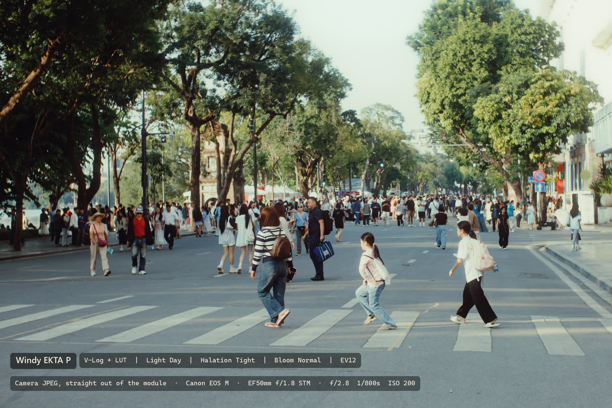
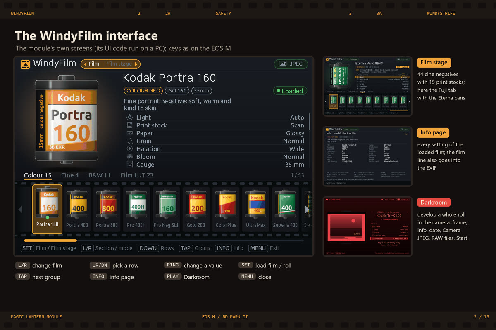
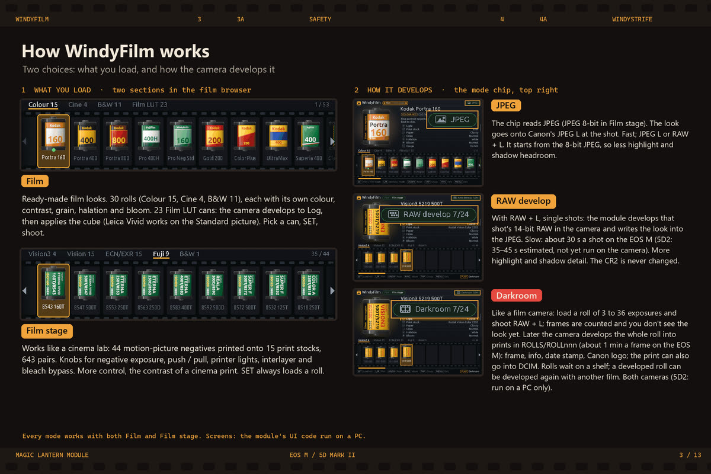
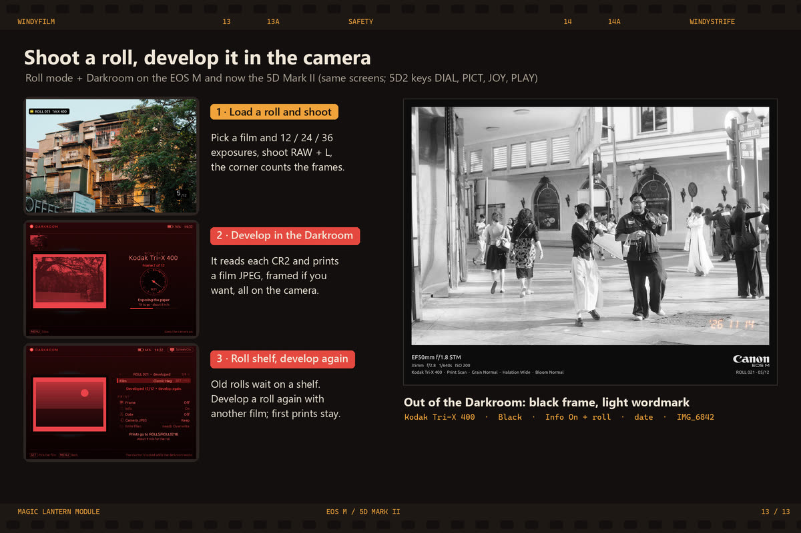
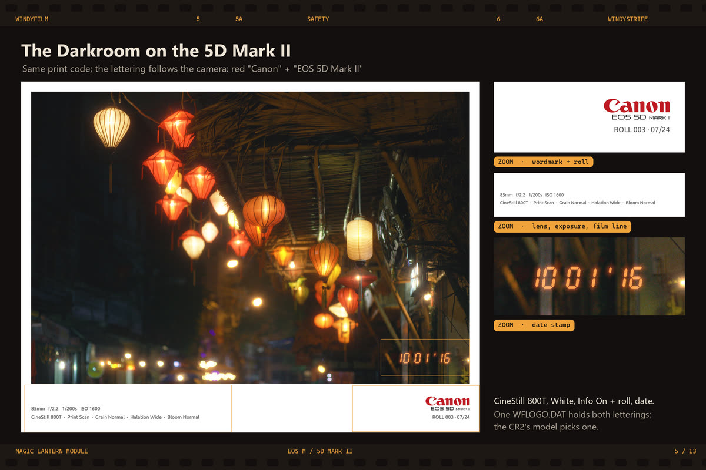
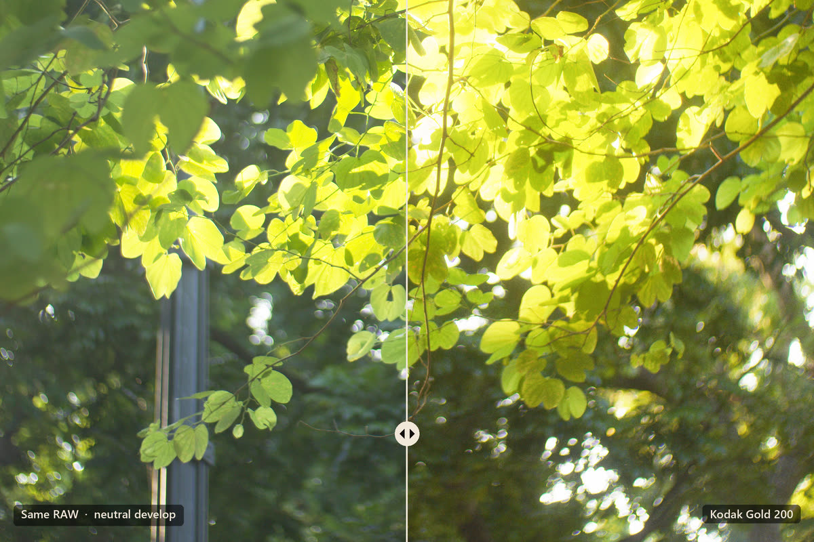
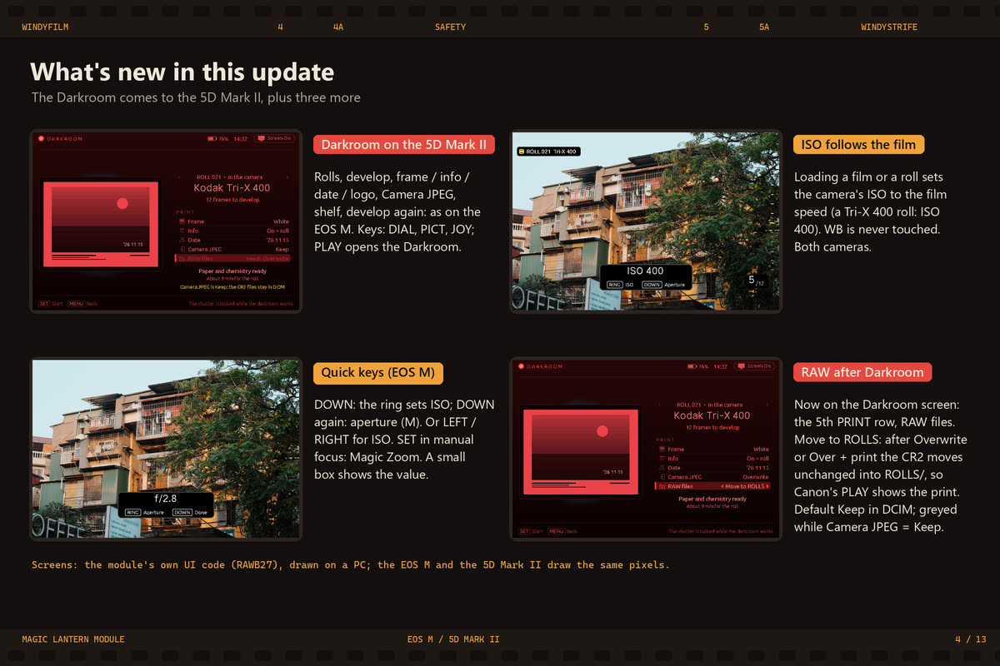

# WindyFilm

[Tiếng Việt](README.md) · [English](README.en.md) · **中文** · [日本語](README.ja.md) · [한국어](README.ko.md)

适用于 **Canon EOS M (firmware 2.0.2)** 和 **Canon EOS 5D Mark II (2.1.2)** 的 Magic Lantern 模块。WindyFilm
让你在相机里得到胶片色彩：拍摄时给 JPEG 套上胶片风格，在机内冲洗 14-bit RAW，或者先拍完一整卷，再在
Darkroom（暗房）里冲洗成带边框的照片。作者：**WindyStrife**。许可证 GPL-3.0-or-later（`LICENSE`）；第三方数据的出处见
`ATTRIBUTIONS.md`。



> **当前版本：RAWB27**（标签 `RAWB27`，分支 `main`）。主机测试：EOS M 2289 项检查，5D2 1832 项检查，0 项失败。
> **尚未在相机上实测**：5D2 的 Darkroom 和 RAW develop、把 CR2 移到 ROLLS、RAW files 行、Quick keys、按胶片设定
> ISO。最新状态（分支、存储卡、未完成事项）见 `docs/HANDOFF.md`。

WindyFilm 是一个独立模块，取代旧的“Film Roll port”。它不使用、不加载、也不包含 `filmroll.mo` 模块中的任何内容。
**请勿同时启用这两个模块。**

## 界面

用快捷键打开：**EOS M** 在 LiveView 中按住 DOWN；**5D Mark II** 按 TRASH。
同一个屏幕上显示胶卷盒、胶片名称和标签、各个设置行、一条 35 mm 胶片条，以及右上角的模式标签。



| 操作 | EOS M | 5D Mark II |
|---|---|---|
| 切换胶片 | 左 / 右 | 摇杆左 / 右 |
| 选择行 | 上 / 下 | 摇杆上 / 下 |
| 修改数值 | 背面转环 | 顶部或背面转盘；或按下摇杆，再按左 / 右 |
| 装入胶片 / 胶卷 | SET | SET |
| 下一组胶片 | 单指轻点 | PICT（照片风格按钮） |
| Info 页 | INFO | INFO |
| Darkroom | PLAY | PLAY |
| 关闭 | MENU 或双指轻点 | MENU 或 TRASH |

半按或全按快门都会关闭界面，相机照常拍摄。

## 工作原理

你要做两个选择：**装入什么**（Film 或 Film stage）和**相机怎样冲洗**（JPEG、RAW develop 或 Darkroom）。
每种模式都同时适用于 Film 和 Film stage。



**装入什么**
- **Film**：现成的胶片风格。30 卷（Colour 15、Cine 4、B&W 11），每卷都有各自的色彩、反差、颗粒、光晕和辉光。
  另有 23 个 **Film LUT** 胶卷盒：相机先记录 Log，再套用 cube。
- **Film stage**：像电影冲印厂一样工作。44 种电影负片印到 15 种拷贝片上（643 种组合）。
  设置行包括负片曝光、增感 / 减感（push / pull）、RGB 配光、层间效应（interlayer）和留银（bleach bypass）。

**相机怎样冲洗**（模式标签）
- **JPEG**（在 Film stage 中为 *JPEG 8-bit*）：拍摄时把胶片风格加到 Canon 的 JPEG L 上。速度快，但它从 8-bit
  JPEG 出发，所以高光和暗部的细节较少。
- **RAW develop**：用 RAW + L 拍摄，一次一张。模块在相机里冲洗这一张的 14-bit RAW，并把胶片风格写入
  JPEG，在 EOS M 上每张约 30 秒。保留的细节更多。CR2 始终不会被改动。
- **Darkroom**：像胶片相机一样。装入一卷 3–36 张的胶卷，用 RAW + L 拍摄；相机只记张数，你暂时看不到胶片效果。
  之后相机把整卷冲洗成冲印照片，存放在 `ROLLS/ROLLnnn`（在 EOS M 上每张约 1 分钟）。

**胶片设置行**：Light（Auto · Day · Cloudy · Shade · Tungsten）、Print stock、Paper（Glossy · Matte · Warm ·
Cool）、Grain、Halation、Bloom、Gauge，以及用于胶卷的 Exposures。
*Light Auto* 保留你的白平衡；其他选项按胶片设定白平衡，回到 Auto 或关闭模块时，你自己的白平衡会恢复。
装入胶片或胶卷时，会**按胶片设定相机的 ISO**。

## Darkroom



Darkroom 屏幕上的 **PRINT** 区块：
- **Frame**：Off · White · Black · White wide · Black wide（照片四周的相纸边框）。
- **Info**：Off · On · On + roll（镜头、曝光参数、胶片名称行、卷号）。
- **Date**：胶片相机式的日期印记。
- **Camera JPEG**：Keep（冲印照片留在 ROLLS 中）· Overwrite（冲印照片替换 DCIM 中的 JPEG）· Over + print（在 DCIM
  中保留照片，并在旁边加上带边框的冲印照片 `WFP_nnnn.JPG`）。
- **RAW files**：Keep in DCIM · Move to ROLLS。只有当 Camera JPEG 为 Overwrite 或 Over + print 时 CR2 才会移动，而且要等
  JPEG 检查无误之后；CR2 的内容始终不会被改动。这与 ML 菜单中的 *RAW after Darkroom* 是同一个设置。

冲洗好的胶卷放在 **shelf**（胶卷架）上等待。一卷胶卷可以换另一种胶片重新冲洗（输出到
`ROLLnnnB`），第一次的冲印照片仍会保留。相机冲洗时可以关闭屏幕（Screen Off）以节省电量。



## 处理前 / 处理后



## RAWB27 新功能



- 5D Mark II 上的 Darkroom，屏幕与 EOS M 相同。
- Darkroom 屏幕上的 **RAW files** 行。
- 两台相机都支持**按胶片设定 ISO**。
- EOS M 上的 **Quick keys**：短按 DOWN 后转环用来设定 ISO；再按一次 DOWN 则设定光圈（M 模式）；手动对焦时按 SET 打开
  Magic Zoom。
- 冲印照片上的说明文字更粗、更易读。

完整列表见 RAWB27 的发布页面，那里也附有 PDF 说明书（越南语和英语）。

## 存储卡

一张 WindyFilm 存储卡的内容放在它自己的文件夹里（例如 `EOSM_WindyFilm_RAWB27`、`5D2_WindyFilm_RAWB27`），由
`tools/mk_card.sh` 用构建结果加上项目所有者的私有数据生成。存储卡内容不在本仓库中。

```
autoexec.bin, ML/modules/<camera>.sym  always a matching pair; keep the pair you have
ML/modules/windyflm.mo                 the module
ML/data/WFFILMS.DAT                    the films' colour tables
ML/data/WFSTAGE.DAT, WFSTLOG.DAT       Film stage (JPEG 8-bit, RAW develop)
ML/data/WFLOG.DAT                      RAW develop tables
ML/data/WFPRINT.DAT, WFLOGO.DAT        paper, lettering and logo for the print frame
ML/data/WFCANS.DAT, WFFONTS.DAT        film can pictures, interface fonts
ML/data/*.CUB                          Film LUT cubes
ML/SETTINGS/WINDYFLM.EN                loads the module at start-up
README_WINDYFILM.txt, MD5SUMS.txt and the licence files
```

WindyFilm 存储卡上不能有 `filmroll.mo`。

## 构建与测试（WSL Ubuntu-24.04）

```bash
bash build.sh CAM=EOSM
bash build.sh CAM=5D2
bash test.sh
```

请在 WSL 中通过脚本文件运行它们。`build.sh` 会检查：
- 模块用到的每个符号都在存储卡的 `.sym` 文件中；
- TCC 链接时映像大小不超出限制；
- 来源门禁（`tools/provenance_gate.py`）通过：没有任何字符串或字节序列与旧模块相同。

不要同时运行 EOS M 和 5D2 的测试套件。

## 文档

- `docs/HANDOFF.md`：唯一的入口：当前状态、分支图、存储卡、未完成事项、日志。
- `docs/DESIGN.md`：架构、存储卡文件格式、各部分之间的接口。
- `docs/UI-NOTES.md`、`docs/CORE-NOTES.md`、`docs/DATA-NOTES.md`：关于界面、ML 核心和数据的笔记。
- `ATTRIBUTIONS.md`：第三方数据与规格的致谢。

*README 图片：屏幕画面是模块自己的界面代码在 PC 上运行的结果（EOS M 和 5D2 绘制出相同的像素）；
冲印照片和照片属于项目所有者，由运行 WindyFilm 的相机拍摄。*
